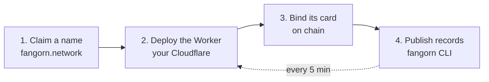

import Tabs from '@theme/Tabs';
import TabItem from '@theme/TabItem';

# Build an app

An app is a view over what publishers have published: your choice of repos, your search, your
site. It runs as a Worker on your own Cloudflare account, and nobody has to let you in.

- **Agents find it.** Every agent with `fangorn-mcp` can list it, verify it and call its tools.
- **People search it.** Its site searches by meaning, in the reader's tab.
- **No server to run.** It runs on Cloudflare's free plan, and each push to its repo redeploys it.

You bring the data, a Cloudflare account and a wallet.



## The fast way: ask your agent

Install the builder plugin, then say **"Build a Fangorn app from &lt;your data&gt;."**

<Tabs groupId="agent">
<TabItem value="claude" label="Claude Code">

```text
/plugin marketplace add fangorn-network/westmarch
/plugin install fangorn-builder@fangorn
```

</TabItem>
<TabItem value="codex" label="Codex">

```bash
codex plugin marketplace add fangorn-network/westmarch
codex plugin add fangorn-builder@fangorn
```

</TabItem>
</Tabs>

| Skill | What it does |
|---|---|
| **`fangorn-app`** | Builds the app in two stages. **Register** (minutes): claim the name, put up a page and bind the card, so something real exists right away. **Build** (hours): your questions first, then your sources, then a local build graded against those questions. No record goes on chain until the build passes. |
| **`fangorn-improve`** | Keeps a live app improving, one gated pull request at a time: a failing guardrail, a broken source, the largest coverage gap or the weakest question. It proves the fix with `westmarch-eval` and never publishes, deploys or merges. Run it by hand or on a schedule with `/loop`. |

## By hand

### 1. Claim a name

Sign in at [fangorn.network](https://fangorn.network/#/account) and claim your app's name.
Claiming is free; the wallet that claims a name owns it.

### 2. Deploy the template

[](https://deploy.workers.cloudflare.com/?url=https://github.com/fangorn-network/westmarch/tree/main/template)

Name the Worker after the app (`my-app`) and its R2 bucket `my-app-view`. Cloudflare copies
the template into your GitHub, makes the bucket and deploys; every push to `main` deploys again.
A name with a dot or an underscore can't be a Worker name: set `"app"` in `app.json` to the
name you claimed.

The template holds the app's recipe, not its data:

| File | What it is |
|---|---|
| `app.json` | The app: its name, description, the record types it shows and how their fields map to title, text and tags (`role_map`) |
| `eval/` | What a good answer looks like: the questions the app must answer |
| `wrangler.json` | The Worker, its R2 view and its 5-minute cron |

### 3. Bind it

Back at fangorn.network, give the app its Worker's URL. Your wallet registers the app's
ERC-8004 agent and binds its card on chain. From then on, `fangorn-mcp` lists it.

### 4. Publish data

Any wallet can commit records of the app's type, from anywhere:

```bash
npm i -g @fangorn-network/sdk
fangorn init                     # choose Base Sepolia and give it a wallet key
fangorn repo init items
fangorn commit items.json
fangorn push
```

`items.json` is `{"records":[{"id","type","payload"}]}`, with `type` one of the types in
`app.json`. The Worker picks the push up on its next cron. To charge for some fields, see
[Sell records](/sell-records).

:::warning
Anyone with your private key controls your wallet. Paste it only into your own terminal,
never into a chat (including with an agent), a website or an email.
:::

## Reference

- [`docs/app-to-agent.md`](https://github.com/fangorn-network/westmarch/blob/main/docs/app-to-agent.md):
  the full walkthrough, with every file's source. The `fangorn-app` skill follows it section by section.
- [westmarch README](https://github.com/fangorn-network/westmarch#readme): `westmarch-ship`,
  `app.json` and the other CLIs.
