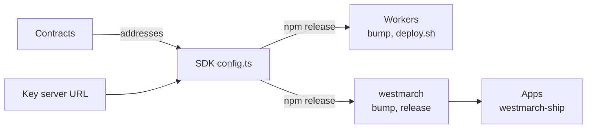

# Deploy Fangorn

This page is for whoever runs a Fangorn network: the contracts, the SDK release, the three
Workers and westmarch. App owners don't need it; they use [Build an app](/build-an-app).

Fangorn is five pieces in five repos. Each one reads the one before it, so they deploy in
order, and a change to one tells you which of the others have to move.

## The pieces

| Piece | Repo | What it is | Where it runs |
|---|---|---|---|
| Contracts | `contracts` | `DataRegistry` (every repo's head) and `SettlementRegistry` (prices, splits, who may read), each behind a UUPS proxy | Base Sepolia |
| SDK | `fangorn` | `@fangorn-network/sdk` and the `fangorn` CLI. **Its `src/config.ts` is the one place addresses live** | npm |
| Storage worker | `webworker/pinata-url-provider` | Presigned Pinata uploads under quotas | Cloudflare |
| Key server | `webworker/fangorn-access-worker` | Releases a paid field's key once `canRead` says the reader paid | Cloudflare |
| Barliman | `webworker/barliman` | Relay and x402 facilitator: sends commits, `register` and `settle`, paying gas from the treasury | Cloudflare |
| westmarch | `westmarch` | `westmarch-ship`, the app Worker, `fangorn-mcp` and the buyer | npm; each app deploys its own Worker |



Nothing reads an address from anywhere but the SDK. The workers take `RPC_URL`,
`DATA_REGISTRY` and `SETTLEMENT_REGISTRY` as overrides, but only for local runs against anvil;
in production they are unset. So **a deployment moves by releasing the SDK and bumping it
everywhere**, and two pieces on different SDK versions are quietly on different contracts.

## What each change needs

| You changed | Then |
|---|---|
| A contract, keeping its storage layout | Upgrade it in place. Addresses and state stay. If the ABI changed: release the SDK, then bump it in the workers and westmarch |
| A contract, breaking its layout | Redeploy. Everything below starts over: new addresses, an empty registry, every repo and deposit gone |
| SDK code | Release it; bump it wherever the change matters |
| A worker | `./deploy.sh <worker>` in `webworker` |
| The key server's secret or URL | **Don't.** See [the key server](#the-key-server) |
| westmarch | Release it; apps pick it up on their next `westmarch-ship` |

## Before you start

- Foundry (`forge`, `cast`, `anvil`) and Node 20+ with pnpm.
- An admin wallet for the contracts, imported into a Foundry keystore
  (`cast wallet import admin-base --interactive`). A hardware wallet works with `--ledger`.
- A treasury wallet for Barliman, holding Base Sepolia ETH. It pays the gas on every relayed
  transaction and receives the referral share of every sale through Barliman.
- A Cloudflare account (`npx wrangler login`), and a domain on it for the key server.
- A Pinata JWT and gateway for the storage worker.
- The repos checked out side by side under one directory. The local tests find each other by
  their sibling paths (`../contracts`, `../webworker`).

## 1. Rehearse locally

Run the whole sale on one machine before touching a real chain. From `westmarch`:

```bash
npm run e2e:paid
```

It starts anvil with the contracts (and mock USDC and Semaphore), the key server and Barliman
under `wrangler dev`, and an app Worker. A publisher seals a record with `sealRecords` (what
`fangorn commit --paid` runs). A buyer is quoted, pays through Barliman, settles and opens the
field. It checks the publisher got the price less 5% and the treasury the 5%. It needs no
Cloudflare login. Use `FANGORN_CONTRACTS_DIR` and `FANGORN_WEBWORKER_DIR` if the repos aren't
siblings.

The SDK's own end-to-end tests run the paid path against anvil too:

```bash
cd fangorn
FANGORN_CONTRACTS_DIR=../contracts pnpm test:e2e src/e2e/paid.e2e.test.ts
```

## 2. Contracts

Skip this for an existing network: Base Sepolia's addresses are already in the SDK. Change a
deployed contract by upgrading it, never redeploying. A redeploy starts an empty registry at a
new address.

**First deployment**, from `contracts`:

```bash
forge script script/Deploy.s.sol --force --sig "all()" \
  --rpc-url <rpc> --account <keystore> --sender <admin> --broadcast
```

`ADMIN_ADDR` is required. `USDC_ADDR` and `SEMAPHORE_ADDR` default to Base Sepolia's and are
required on any other chain. Afterwards:

1. Write the proxy addresses into `script/Deployments.sol`.
2. Commit the builds under `deployed/<chain id>/` and the broadcast log. The next upgrade is
   checked against them.
3. Note the DataRegistry's deployment block. The SDK scans its log from there.

**Upgrade** (rehearse it first on a fork with `anvil --fork-url <rpc> --auto-impersonate`):

```bash
forge script script/Upgrade.s.sol --force --sig "upgrade(string)" DataRegistry \
  --rpc-url <rpc> --account <keystore> --sender <admin> --broadcast
```

Storage is append-only. The contracts repo's README covers the rules and the safety checks.

## 3. Choose the key server's URL

Do this before the SDK release, because the release carries it.

Every paid repo's `@deposit` record names the key server that holds its key, for good. So the
key server must live at a URL you control and will never move, a custom domain on Cloudflare,
not a `workers.dev` address. Choose it now (for example `keys.fangorn.network`) and route it
to the `fangorn-access-worker` Worker in step 5.

## 4. Release the SDK

In `fangorn/src/config.ts`, the network's entry holds everything the rest reads:

| Field | From |
|---|---|
| `dataRegistryContractAddress`, `settlementRegistryContractAddress` | step 2, the proxies |
| `fromBlock` | the DataRegistry's deployment block |
| `rpcUrl` | an RPC that allows wide `eth_getLogs` ranges (public `sepolia.base.org` caps them at 200 blocks) |
| `signedUrlWorker` | the storage worker's URL |
| `keyServer` | step 3. Leave it unset until the key server is actually up: `fangorn commit --paid` refuses to seal without one |

Then publish a release (`2026.MM.DD` or `…-dev`). Until `keyServer` is set, publishers can pass
`FANGORN_KEY_SERVER=<url>` to the CLI.

## 5. Deploy the Workers

In `webworker`, bump `@fangorn-network/sdk` to the new release in each package and
`pnpm install`. Then set each worker's secrets, once. Redeploys leave them alone.

| Worker | Secret | Vars and bindings |
|---|---|---|
| Storage | `PINATA_JWT` | `RATE_KV` |
| Key server | `WORKER_X25519_SECRET`: 32 random bytes as hex | none. Add the domain from step 3 as a route |
| Barliman | `TREASURY_KEY`: the treasury wallet's private key | `TREASURY`, the treasury's address, under `[vars]`; `RATE_KV` |

```bash
cd fangorn-access-worker && openssl rand -hex 32 | tee ks-secret.txt | npx wrangler secret put WORKER_X25519_SECRET
cd ../barliman && npx wrangler secret put TREASURY_KEY
npx wrangler kv namespace create RATE_KV     # put the printed id in barliman/wrangler.toml
cd ../pinata-url-provider && npx wrangler secret put PINATA_JWT
```

Move `ks-secret.txt` somewhere safe (a password manager), then delete it.

Then deploy:

```bash
./deploy.sh --dry-run all     # bundle and check everything, deploy nothing
./deploy.sh all               # or any subset: ./deploy.sh access barliman
```

Before deploying, `deploy.sh`:

- prints which SDK version and contracts each package resolves;
- refuses a set whose SDK versions disagree;
- refuses Barliman without `TREASURY`;
- warns about secrets that aren't set;
- prints the key server URL the SDK will deposit with. If it isn't the URL you chose in step 3, stop.

Check each one answers:

```bash
curl https://<key server>/pubkey          # the key server's public key
curl https://<barliman>/supported         # scheme "fangorn", extra.referrer = TREASURY
```

### The key server

The key server's secret and URL are the two things in Fangorn that can't change once used.

- **Every deposit is sealed to `WORKER_X25519_SECRET`.** Lose it or rotate it, and every paid
  repo deposited with this key server can never be opened again. Back it up before the first
  publisher uses it.
- **Every deposit names the key server's URL.** Move it, and buyers of those repos ask an
  address that no longer answers.

It also stores nothing and can decrypt anything deposited with it. A publisher who won't trust
Fangorn's runs the same Worker on their own account and seals with their own URL.

## 6. Release westmarch

In `westmarch`, move `@fangorn-network/sdk` to the new release (the dev dependency points at
the sibling checkout, `file:../fangorn`; the release must not) and run `npm test` and
`npm run e2e:paid` again. Then publish. Apps take it on their next `westmarch-ship app.json`,
which rebuilds and redeploys their Worker. A paid app names Barliman in `app.json`
(`"paid": true`, `"facilitator": "<barliman URL>"`).

## 7. Verify with a real sale

From `westmarch`, against the deployed workers, with three different wallets:

```bash
PUBLISHER_KEY=0x… BUYER_KEY=0x… TREASURY=0x… \
KEY_SERVER_URL=https://<key server> BARLIMAN_URL=https://<barliman> \
PINATA_JWT=… PINATA_GATEWAY=… \
node scripts/sale-live.mjs
```

| Variable | Needs |
|---|---|
| `PUBLISHER_KEY` | a little Base Sepolia ETH, for its commits |
| `BUYER_KEY` | USDC on Base Sepolia, at least the price ([faucet](https://faucet.circle.com)). No ETH |
| `TREASURY` | Barliman's `TREASURY`, so the split can be checked |

It runs one real purchase: a publisher seals and commits a record, the buyer pays, proves with a
real Semaphore proof, settles and opens the field. It then checks the publisher got 95% and the
treasury 5%. It refuses to start when two of the wallets are the same. Leave `KEY_SERVER_URL`
or `BARLIMAN_URL` unset to run that service locally instead. A local key server makes a deposit
only that run can open, which is fine for a test.

## Checklist

1. `npm run e2e:paid` passes.
2. Contracts deployed or upgraded; `Deployments.sol` and `deployed/` committed.
3. Key server domain chosen.
4. SDK released with the addresses, `fromBlock` and URLs.
5. Workers bumped to that release; secrets set; `WORKER_X25519_SECRET` backed up; `./deploy.sh all`.
6. `/pubkey` and `/supported` answer; `keyServer` set in the SDK and released.
7. westmarch bumped and released.
8. `scripts/sale-live.mjs` passes against the deployed workers.
