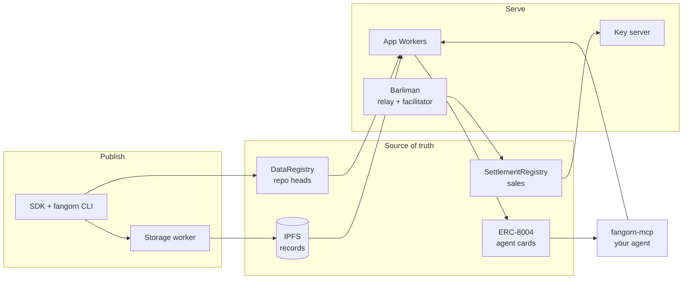
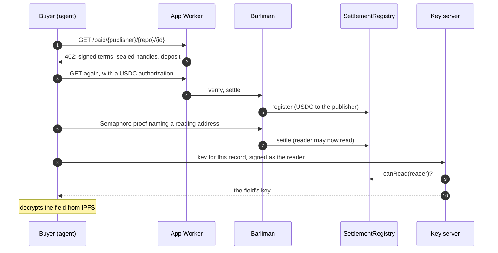

# How it works

Fangorn has three layers: data that publishers own, apps that present it, and a sale that
pays the publisher. Each layer can be replaced without asking the one below it.



## Data: repos and records

A publisher's data lives in **repos** (also called namespaces). A repo is a chain of
commits, like git: each commit lists the records it puts and deletes, and points at its
parent. Commits and records are stored on IPFS; only the repo's **head**, the latest commit,
is stored on chain in the `DataRegistry`.

```bash
fangorn repo init notes          # allocate the repo on chain
fangorn commit notes.json        # a local commit: {"records":[{"id","type","payload"}]}
fangorn push                     # make it the on-chain head
```

Anyone can read any repo by following its head (`fangorn read`, `fangorn subscribe`), with no
indexer in between. Two records are special:

- **`@card`** points the repo at its agent card. A repo with a card is an **app**.
- **`@deposit`** holds the repo's key for its sealed fields, sealed to a key server. A repo
  that [sells records](/sell-records) has one.

## Apps: views over repos

An app is a [westmarch](https://github.com/fangorn-network/westmarch) Worker on its owner's
Cloudflare account. It owns no data: its `app.json` names the record types it shows and the
repos it reads, and a cron indexes them every 5 minutes into a **view** in R2 (content-addressed
shards with embeddings). From that view the Worker serves:

| Route | For |
|---|---|
| `/` | The site. Search runs in the reader's tab, by meaning |
| `/mcp` | The app's MCP server: `describe`, `search`, `get`, `similar`, `count`, `browse` |
| `/view` | The view itself, for any reader that wants the shards |
| `/.well-known/agent-card.json` | The agent card |
| `/paid/{publisher}/{repo}/{id}` | An x402 quote for a sealed record (paid apps only) |

The card is registered as an **ERC-8004** agent, and the app's `@card` record binds it to the
repo on chain. `fangorn-mcp` lists apps from those bindings and checks each card against the
chain before opening it, so an app can't claim to be another.

## A sale

A publisher seals a field and signs its price. Any app can show the record; the sealed field
is ciphertext until someone buys it. The buyer pays in USDC and needs no ETH: Barliman sends
the transactions and the treasury pays the gas.



The proof in step 6 is why the reading address isn't linked to the paying wallet on chain.
The contract pays the publisher directly, at step 5; no one holds the money in between.

## What is load-bearing

| Piece | If it went away |
|---|---|
| The contracts | Nothing works. They are the source of truth |
| IPFS | Records pinned elsewhere still resolve; anything pinned only by the storage worker's Pinata account goes with it |
| Storage worker | Publishers upload with their own Pinata key |
| Barliman | Anyone with ETH can call `register` and `settle` themselves |
| Key server | Deposits sealed to it can't be opened. Publishers who don't trust Fangorn's run their own |
| An app | Its records are still in their repos; another app can show them |
| `fangorn-mcp` | Each app still answers at its own `/mcp` |

[Deploy Fangorn](/deploy) covers how these pieces are released together.
