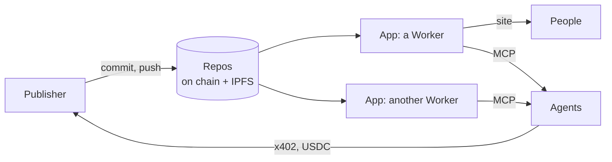

import Tabs from '@theme/Tabs';
import TabItem from '@theme/TabItem';

# Fangorn

Fangorn is a place to publish data so that people and agents can both use it, and so that
the people who made it can be paid.

- **Publishers** commit records to repos. Each repo's head is on chain (Base Sepolia); the
  records themselves are on IPFS. A publisher can seal some fields and price them in USDC.
- **Apps** are views over publishers' repos. Each one is a Worker on its owner's Cloudflare
  account that serves a site people search by meaning, an MCP endpoint agents call, and an
  agent card bound on chain so any agent can find and check it.
- **Agents** find apps through one MCP server, `fangorn-mcp`, and buy sealed records over
  x402. The publisher is paid directly by the contract.



No one has to let you in. Anyone can publish, anyone can build an app over anyone's repos,
and any agent can verify an app against the chain before trusting it.

## Get started

Everything starts from a coding agent, through two plugins from one marketplace:

| Plugin | For | What you get |
|---|---|---|
| **`fangorn-index`** | Using apps | The `fangorn` MCP server, which lists, opens and pays apps, and the `fangorn-index` skill, which finds the right app and carries your taste between apps |
| **`fangorn-builder`** | Building apps | The `fangorn-app` skill, which builds, publishes and registers an app, and `fangorn-improve`, which keeps it improving |

<Tabs groupId="agent">
<TabItem value="claude" label="Claude Code">

```text
/plugin marketplace add fangorn-network/westmarch
/plugin install fangorn-index@fangorn     # use apps
/plugin install fangorn-builder@fangorn   # build apps
```

</TabItem>
<TabItem value="codex" label="Codex">

```bash
codex plugin marketplace add fangorn-network/westmarch
codex plugin add fangorn-index@fangorn     # use apps
codex plugin add fangorn-builder@fangorn   # build apps
```

</TabItem>
</Tabs>

## Where to next

| You want to | Read |
|---|---|
| Search apps and buy records from your agent | [Use apps](/use-apps) |
| Find which app has what, and carry your taste between them | [The fangorn-index skill](/index-skill) |
| Turn a dataset into an app | [Build an app](/build-an-app) |
| Charge for what you publish | [Sell records](/sell-records) |
| Understand the pieces and how a sale works | [How it works](/how-it-works) |
| Run the contracts, SDK and Workers yourself | [Deploy Fangorn](/deploy) |

Fangorn runs on Base Sepolia, a testnet. Its USDC is test USDC from
[Circle's faucet](https://faucet.circle.com).
