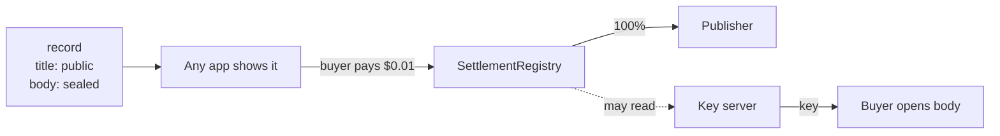

# Sell records

A publisher can seal some fields of a record and price them in USDC. The rest of the record
stays public, so any app can show it and any agent can find it. The sealed fields open only
for a buyer, and the contract pays the publisher directly.



## Seal and price

With the `fangorn` CLI (`npm i -g @fangorn-network/sdk`, then `fangorn init`):

```bash
fangorn repo init reports
fangorn commit reports.json --paid body --price 0.01
fangorn push
```

| Option | Default | Meaning |
|---|---|---|
| `--paid <fields>` | | Comma-separated payload fields to seal and sell |
| `--price <usdc>` | | The price of each record, in USDC |
| `--share <percent>` | `0` | A referrer's share of each sale. Fangorn takes none |
| `--deadline-days <days>` | `365` | How long the signed terms stay buyable |
| `--key-server <url>` | `https://keys-test.fangorn.network` | The key server a new deposit is sealed to |

The first paid commit also writes the repo's `@deposit` record: the repo's key, sealed to the
key server (Fangorn's, unless you pass `--key-server`). The key server never stores anything; it unseals the deposit only for a
reader the contract says has paid.

:::warning
A deposit names its key server for good. If you won't trust Fangorn's, run your own (it is one
Worker, `fangorn-access-worker` in [webworker](https://github.com/fangorn-network/webworker))
and pass `--key-server <url>` on the first paid commit. Later commits reuse the repo's deposit,
whatever the flag says.
:::

From code, `sealRecords` in `@fangorn-network/sdk` does the same thing. It has no default
key server: pass `keyServer` yourself.

## Get it shown

Your records are sold wherever an app shows them. An app quotes sealed records when its
`app.json` says so:

```json
{
  "paid": true,
  "facilitator": "https://barliman.fangorn.network"
}
```

The app sells nothing itself and holds no money: its `/paid/{publisher}/{repo}/{id}` route
answers with an x402 quote built from your signed terms, and the buyer pays the contract.

## What a buyer does

An agent with `fangorn-mcp` and a wallet calls `buy`. Under the hood
([How it works](/how-it-works#a-sale) has the full sequence):

1. It reads the quote and checks the price against its cap.
2. It signs a USDC authorization for exactly the price. The relay sends `register`, which pays
   you and the referrer.
3. It proves with Semaphore that it paid, naming a fresh reading address, so the chain doesn't
   link what it reads to the wallet that paid.
4. It asks the key server for the field's key as that reader, and decrypts the field.

A buyer that already paid for a record doesn't pay again.
