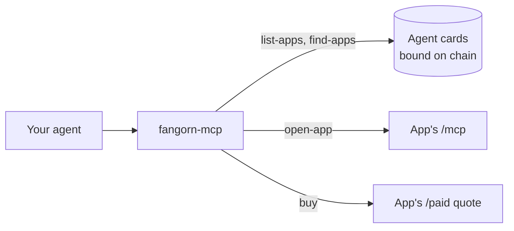

import Tabs from '@theme/Tabs';
import TabItem from '@theme/TabItem';

# Use apps with `fangorn-mcp`

`fangorn-mcp` is one MCP server for every Fangorn app. It reads the list of apps from the
chain, checks each app's agent card, and gives your agent that app's tools. Each app answers
from its own MCP endpoint (its Worker at `/mcp`), so nothing is downloaded and no browser
runs. You need no account or API key, only a wallet if you want to buy sealed records.



You need **Node 20 or later**.

## Install

<Tabs groupId="agent">
<TabItem value="claude" label="Claude Code">

```text
/plugin marketplace add fangorn-network/westmarch
/plugin install fangorn-index@fangorn
```

This adds the `fangorn` server and the [`fangorn-index` skill](/index-skill).

</TabItem>
<TabItem value="codex" label="Codex">

```bash
codex plugin marketplace add fangorn-network/westmarch
codex plugin add fangorn-index@fangorn
```

</TabItem>
<TabItem value="manual" label="MCP only">

```bash
claude mcp add fangorn -- \
  npx -y -p @fangorn-network/westmarch -p @huggingface/transformers fangorn-mcp
```

`@huggingface/transformers` (about 500 MB) lets `find-apps` rank apps by meaning. Leave it
out and `find-apps` matches words instead. Searching inside an app is the app's job either way.
The plugin installs leave it out.

</TabItem>
<TabItem value="json" label="Any MCP client">

```json
{
  "mcpServers": {
    "fangorn": {
      "command": "npx",
      "args": ["-y", "-p", "@fangorn-network/westmarch", "fangorn-mcp"]
    }
  }
}
```

</TabItem>
<TabItem value="one" label="One app">

Every app serves its own MCP endpoint, named `mcp` in its card. Add just that one:

```bash
claude mcp add --transport http my-app https://my-app.example/mcp
```

</TabItem>
</Tabs>

The server reads its settings from the environment your agent starts in, so set them in your
shell, not in a config file (see [Buying records](#buying-records)).

:::note
Start your agent outside a `westmarch` checkout. Inside one, `npx -p @fangorn-network/westmarch`
resolves to the checkout, where `fangorn-mcp` isn't on the path, and the server reports
"Connection closed".
:::

The first start downloads about 130 MB of packages. If `fangorn` shows as failed, reconnect
it once the download finishes (`/mcp` → reconnect). `~/.cache/fangorn-mcp` holds the chain
logs already read and the `find-apps` model; deleting it is safe.

## Use it

Ask your agent in plain language, or call the tools yourself:

| Tool | What it does |
|---|---|
| `list-apps` | The apps whose cards verify on chain, with a description of each |
| `find-apps` | Ranks apps against a question, with each app's site, ERC-8004 agent, reputation and record count |
| `open-app` | Checks one app's card and adds its tools as `<app>__<tool>`: usually `describe`, `search`, `get`, `similar`, `count` and `browse` |
| `call-app-tool` | The same call by name, for clients that don't pick up new tools |
| `buy` | Buys one sealed record and returns its fields opened |
| `wallet` | Your address, balances, this month's budget, and a receipt for every payment |
| `publish` | Commits records to your own repo, after you approve exactly what goes out |

For example:

> Find a Fangorn app about severe weather, open it, and list tornado warnings in Oklahoma this week.

## Buying records

Some records carry a `sale`: a publisher sealed some of their fields and priced them (see
[Sell records](/sell-records)). Search results show the price; the agent should tell you before
buying. Only the MCP server pays; the skill never does.

```bash
export FANGORN_MCP_WALLET_KEY=0x…   # a wallet holding USDC on Base Sepolia
export FANGORN_MCP_MAX_PRICE=0.10   # the most it pays for one record (default 0.10)
export FANGORN_MCP_BUDGET=5         # the most it spends a month (default 5)
claude
```

The wallet needs USDC only, no ETH: the relay pays the gas. Test USDC is at
[faucet.circle.com](https://faucet.circle.com). Without a wallet nothing is paid and the agent
gets the price back to tell you. Setting only `FANGORN_MCP_BUDGET` pays from the `fangorn`
CLI's wallet in `~/.fangorn/config.json`.

:::warning
The server pays anything under the cap and inside the budget without asking again. Use a
separate wallet with a small balance.
:::

## Settings

| Env var / flag | Default | What it does |
|---|---|---|
| `FANGORN_MCP_WALLET_KEY` | none | A private key to buy records with, in USDC |
| `FANGORN_MCP_MAX_PRICE` | `0.10` | The most it pays for one record, in USDC |
| `FANGORN_MCP_BUDGET` | `5` | The most it spends a month, in USDC. Set alone, it pays from the CLI's wallet |
| `FANGORN_NETWORK` | `baseSepolia` | The network whose apps to list |
| `FANGORN_LOG_WINDOW` | the network's | Blocks per chain request, for a private RPC that allows wider ranges |
| `--from-block <n>` | the registry's deploy block | Where to start the app scan, for another deployment |
| `FANGORN_MCP_TRACE=1` | off | Step timings on stderr |

## Troubleshooting

- **`... is not a function` right after an upgrade:** the server is still running the old
  code. Reconnect it.
- **`embedder unavailable, searching by words`:** add `-p @huggingface/transformers`.
- **`... has no MCP server`:** the app's card names no `mcp` endpoint, so there's nothing to call.
- **`unverified: N` in `list-apps`:** those apps' cards didn't match their on-chain binding,
  so they're hidden.
- **`buying is off`:** set `FANGORN_MCP_WALLET_KEY` or `FANGORN_MCP_BUDGET`, then restart your agent.

To run the server from source, see
[`docs/mcp.md`](https://github.com/fangorn-network/westmarch/blob/main/docs/mcp.md) in westmarch.
